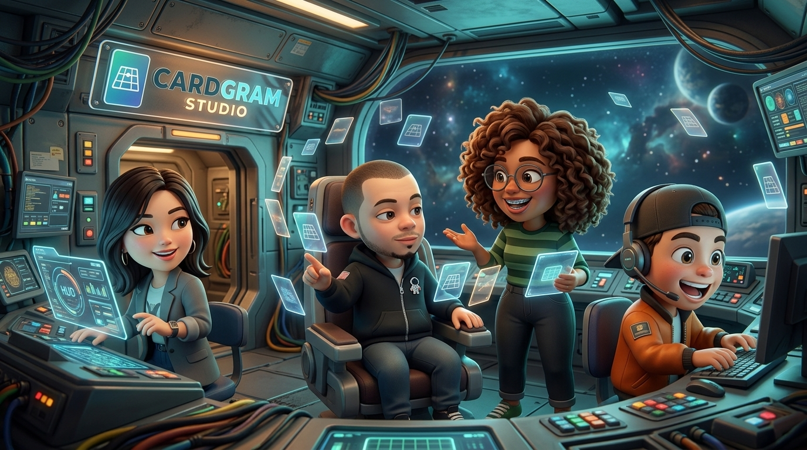

<div align="center">

<!-- Animated SVG logo — spinning card with 3D flip animation -->
<a href="https://theastrobruh.github.io/CardGram/">
  
</a>

<br/>

> **Real-time WebGL 3D showcase & reel creator for trading card artists, digital collectors, and content creators — zero install, runs in your browser.**

[](https://github.com/theastrobruh/CardGram/actions)
[](https://theastrobruh.github.io/CardGram/)
[](https://threejs.org/)
[](#)
[](#-license)
[](https://ko-fi.com/theastrobruh)

<br/>

[**🚀 Open CardGram**](https://theastrobruh.github.io/CardGram/) · [**🖨️ Try Inkra**](https://theastrobruh.github.io/Inkra/) · [**☕ Support the Project**](https://ko-fi.com/theastrobruh)

</div>

---

## 🤖 Meet the Team — AI-Powered Development

<div align="center">



<br/><br/>

</div>

CardGram is built by **[theAstroBruh](https://github.com/theastrobruh)** (Creative Director & CEO) alongside **three AI agents** that act as a real dev crew:

| | Agent | Role | Personality |
|---|---|---|---|
| 🔷 | **Gemini** | Lead Engineer & Architect | The meticulous one. Writes clean code, catches edge cases, loves design systems. |
| 🔶 | **DeepSeek** | Senior Developer & UX Strategist | The sharp executive. Cuts through complexity, ships features fast. |
| ⬜ | **MiMo** | Junior Dev & QA Intern | The everyday dev. Runs the tests, files the bugs, learns something new every sprint. |

> *Every feature, every pixel, every line of code — crafted through human vision + AI collaboration.*

---

## 🆕 What's new in v0.5.5

| | Update | Details |
|---|---|---|
| 🛍️ | **Shop v2** | Daily pack, stock, Azura the vendor, computer for other sellers and an Astro~Verse store |
| 🧪 | **Playable shop stage** | Drag boosters and the store, slide Azura sideways, reset the whole scene in one click |
| 🎚️ | **Azura size control** | Native slider inside the **Azura** menu (55 %–190 %) — no accidental resizing with drag or wheel |
| 🧑‍🔬 | **Export Layout (Dev)** | Downloads a JSON with every element's coordinates, scale and offset so the layout can be reproduced exactly |
| 🧭 | **Top-bar polish** | Back button, day/shift chips and the playground toolbar share one axis, 40 px tall, with Azura on the left by default |
| 📱 | **Mobile sheets** | Identity chip → vitrine → card details sheet → round menu sheet, plus a bottom-sheet card grid |
| 🪪 | **About + Welcome** | Alpha intro, story, feature cards and the “replay welcome” flow |

---

## ✨ Two Products, One Ecosystem

### 🏛️ Card Hub — Your Digital Collection Lobby

The **Card Hub** is your home base — a cinematic, card-first experience where you manage your collection like a real TCG player.

<table>
<tr>
<td width="50%">

**📦 Daily Packs** — Open 6 random cards once a day from the set you choose. Complete collections like Mew Tarot (22/22) or build up Champion-Verse and Dungeons & History.

**🛍️ The Shop** — A cinematic vendor's hall: Azura on the left, today's boosters centred on the stage, the Astro~Verse store on the right, and live stock/rarity rails.

**🃏 My Cards** — Browse saved presets plus the full catalog, mark favorites, and jump into the studio with one tap.

**📚 Collections & Decks** — Organized by set folders, with user-created decks featuring custom covers and card lists.

**👤 Profile** — Local avatar (square crop), creator name, handle, bio, and your featured favorite card.

</td>
<td width="50%">

**🎨 Reactive Ambient Background** — The lobby palette shifts in real-time, sampling pastel hues from your active card's artwork. The glow, shadow, and even the browser's theme color match.

**📱 Card-First Mobile** — One identity chip → your card on a glass vitrine → a single round menu button. No clutter, the card is the UI.

**🔍 Details On Demand** — Collection info, rarity, type, stats, and lore sit behind a compact ⓘ button, so the card always gets the spotlight.

**🌐 Explore (Coming Soon)** — Community feed shell and data adapter are ready and waiting for a backend.

</td>
</tr>
</table>

### 🛍️ The Shop — a stage you can arrange

The Shop is not a static mockup: it is a small physics playground for presenting boosters.

- **Drag & throw** — boosters and the Astro~Verse store follow the pointer, bounce off the stage edges and settle straight.
- **Azura moves sideways** — drag her left or right; she never grows or shrinks from a drag. Her size lives in the **Azura** menu as a native slider (55 %–190 %), together with the position presets *Left · Center · Right · Off screen*.
- **Reset Playground** — restores the approved composition: Azura on the left, the three boosters centred and slightly below the middle, the store on the right.
- **Export Layout (Dev)** — a developer button in the playground toolbar that downloads `cardgram-shop-layout-<date>.json`. It contains the live `rect`, `center`, `centerPct`, `edgePct`, `offset` and `scalePercent` of Azura, the store and every booster, so a layout can be reproduced from CSS without guessing pixels. `window.exportShopLayout()` returns the same object from the console.
- **Responsive by proportion** — booster width scales with the viewport and the row stays anchored to the centre of the stage; the Export Layout label collapses to its icon under 1280 px and the toolbar hides entirely on mobile.

### 🎴 eCard Studio — 3D Card Forge

The **eCard Studio** is where the magic happens — a full procedural 3D engine for crafting, posing, and exporting card showcases.

<table>
<tr>
<td width="50%">

#### 🔧 3D Engine
- **Procedural Geometry** — Accurate TCG rounded corners with adjustable reflective bevels
- **6 Card Formats** — Standard TCG, Yu-Gi-Oh!, Tarot, Mini Euro, Landscape, Square — plus *Auto* that matches your artwork
- **Customizable Edges** — Millennium Foil Gold, Metallic Silver, Matte Black, White Cardstock
- **Specular & Gloss** — Fine-grained roughness, gloss, and reflection control
- **Exposure Control** — Balanced luminosity with manual override to prevent blowout
- **Full Art Transition** — Smooth animated morph from base to full-art variant

</td>
<td width="50%">

#### 🎥 Camera & Motion
- **3 Scene Keyframes** — Store camera angles, targets, and elevations with fluid interpolated transitions
- **Spin Dynamics** — Adjustable speed, CW/CCW toggle, tilt leveling
- **Draggable Radial FAB** — On-canvas shortcuts that auto-orient away from edges
- **Cinematic Mode** — Hide all chrome for pristine captures

#### 📤 Export
- **High-Res PNG** — Single-frame client-side snapshot
- **9:16 Vertical Video** — In-browser MediaStream recording for Reels, TikTok, Shorts — nothing leaves your device

</td>
</tr>
</table>

### 🖨️ Inkra — Real-Scale Print Companion

**[Inkra](https://theastrobruh.github.io/Inkra/)** is the print-layout companion tool that turns your digital cards into physical reality:

- 📐 **Pixel-perfect templates** for standard TCG, Tarot, and custom sizes
- 🖨️ **Print-ready layouts** with bleed, crop marks, and safe zones
- 🎴 **Batch processing** — Lay out entire decks for professional print runs
- 🔗 **One-tap access** from the Card Hub's mobile menu or desktop nav

---

## 💾 More Features

| Category | Details |
|---|---|
| 🎭 **Built-in Presets** | *Shadowblade Kinetic*, *Volt Striker*, *Aureon the Golden Maw*, and more |
| 💿 **Custom Presets** | Save front/back/Full Art combos in browser storage |
| 🧪 **Shop Playground** | Drag boosters and the store with elastic physics; slide Azura sideways; resize her from the Azura menu; one-click reset |
| 🧑‍🔬 **Layout Export (Dev)** | Download a JSON of every shop coordinate, offset and scale — the source of truth for future layout tweaks |
| 🌍 **i18n** | Instant language switching: **English**, **Español**, **Deutsch** (studio, hub and the shop toolbar) |
| 🔊 **Sound Design** | Synthesized Web Audio palette with 5 gesture types — always mutable, never intrusive |
| 🎵 **Music Modes** | *Immersive* (changes per screen) and *Chill* (continuous shuffle) with persisted volume and mute |
| ⚡ **Lazy 3D** | No WebGL on load; render loop pauses while in the lobby |
| 🔒 **Offline-First** | Everything runs locally, even from `file://`. No backend, no tracking |

---

## 🗺️ Roadmap — Building a Community

<div align="center">
  
</div>

<br/>

Our vision is to transform CardGram from a **personal showcase tool** into a **living community platform** where card creators and collectors come together:

| Phase | Status | What's Coming |
|---|---|---|
| **eCard Studio** | ✅ Done | 3D engine, formats, export, presets |
| **Card Hub** | ✅ Done | Lobby, collections, daily packs, shop stage + playground, profile, ambient |
| **Inkra Print** | 🔧 Active | Real-scale layouts, batch printing, custom templates |
| **Community** | 🌐 Planned | **Share your creations** — Public gallery, user profiles, social features |
| **Drops & Marketplace** | ✨ Future | **Create your own drops** — Design card sets, publish limited drops, community voting, trading |

### 🌐 The Community Vision

We want CardGram to become the place where:

- 🎨 **Artists** publish their card art as interactive 3D showcases, not just flat images
- 🃏 **Collectors** discover, save, and organize cards from their favorite creators
- 📦 **Creators** design and release their own **drops** — limited card sets that the community can collect
- 🤝 **Everyone** shares, remixes, and celebrates the art of trading cards

> **This is an open-source, community-driven project.** Every contribution — code, art, ideas, or a cup of coffee — helps us get there faster.

---

## 🚀 Get Started

### Online (Recommended)
👉 **[Open CardGram](https://theastrobruh.github.io/CardGram/)** — Upload your art → Configure the 3D forge → Record or snapshot.

### Local Development

```bash
git clone https://github.com/theastrobruh/CardGram.git
cd CardGram
```

| Method | Command |
|---|---|
| 🪟 Windows | Double-click `Iniciar_Webapp.bat` |
| 🐍 Python | `python -m http.server 8000` → open `http://localhost:8000` |

---

## ⌨️ Keyboard Shortcuts

| Key | Action |
|:---:|:---|
| `1` `2` `3` `4` | Switch studio tabs (Deck · 3D Forge · Shots · Canvas) |
| `C` | Toggle Cinematic Clean Screen |
| `R` | Start / Stop video recording |
| `S` | Capture high-res PNG snapshot |
| `?` | Open shortcuts & help dialog |
| `Esc` | Close dialogs / exit Cinematic Mode |

---

## 🗂️ Project Structure

```
├── index.html                  # Main app (hub + studio + shop markup)
├── Iniciar_Webapp.bat          # Windows local server launcher
├── assets/
│   ├── css/
│   │   ├── app.css             # Studio UI styles (Aqua Glass design system)
│   │   └── hub.css             # Hub, shop stage and playground styles
│   ├── js/
│   │   ├── boot.js             # Boot screen, start gate and app wiring
│   │   ├── welcome.js          # Welcome / About flow and alpha intro
│   │   ├── app.js              # Core studio logic & UI
│   │   ├── scene.js            # Three.js WebGL scene & card geometry
│   │   ├── export.js           # PNG snapshot & video recording
│   │   ├── hub.js              # Hub, shop, playground engine & layout export
│   │   ├── ambient.js          # Reactive background palette
│   │   ├── sound.js            # Synthesized Web Audio palette
│   │   ├── music.js            # Background music (immersive / chill)
│   │   ├── i18n.js             # Studio translations (EN/ES/DE)
│   │   ├── hub-i18n.js         # Hub + shop translations
│   │   └── community.js        # Community feed adapter (prepared)
│   └── data/
│       ├── cards/              # Per-collection folders + catalog.js
│       │   ├── thumbs/         # WebP thumbnails
│       │   └── tools/          # make-thumbs.py
│       ├── shop_assets/        # Shop background, lights, props
│       ├── vendor/azura/       # Azura sprite frames (WebP)
│       ├── shops/              # Astro~Verse store art and avatars
│       ├── sounds/             # UI sound samples
│       ├── loading/            # Boot / loading realities
│       └── readme/             # Logo, banner and roadmap art
├── .github/workflows/
│   └── deploy.yml              # GitHub Actions → GitHub Pages
└── skills/
    └── cardgram-ui/            # Agent guide: file map, rules, references
```

---

## 🛠️ Built With

| Tech | Purpose |
|---|---|
| **[Three.js r128](https://threejs.org/)** | WebGL 3D rendering |
| **Canvas + MediaStream API** | In-browser video encoding |
| **Web Audio API** | Synthesized sound design |
| **HTML5 + Modern CSS3** | Glassmorphic responsive UI, zero build step |
| **Gemini + DeepSeek + MiMo** | AI-assisted development crew |

---

## ☕ Support CardGram

CardGram is **free, open-source, and community-driven**. If it inspires you, helps your art, or just makes you smile — consider fueling the next feature:

<div align="center">

[](https://ko-fi.com/theastrobruh)

*Every coffee helps theAstroBruh (and the AI crew 🤖) ship the next update faster.*

</div>

---

## 📄 License

MIT © 2026 — Free to use, modify, and share.

<div align="center">

*Made with ♥ by theAstroBruh + Gemini + DeepSeek + MiMo*

</div>
